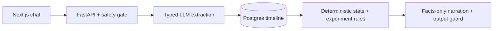

# Nof1

Nof1 is a conversational N-of-1 experiment prototype for people tracking chronic
symptoms. Chat becomes a structured timeline; deterministic statistics surface
**possible lagged patterns**; a 14-day on/off test returns helped, worsened,
no detectable effect, or inconclusive. It is not a diagnostic tool or medical advice.

## One-minute demo

Hosted demo: https://nof1-frontend-196912573980.us-east4.run.app/ (spend-capped; will be torn down shortly after the interview to avoid ongoing cost; after that, use the local steps below).

Use synthetic data only:

1. **Load demo history** to see a seeded timeline and possible pattern.
2. **Test this** on the eligible pattern.
3. **Accept this plan** to confirm the protocol and its displayed start date.
4. **Skip to end** to advance simulated days; inspect the verdict, sample size,
   interval and limitation sentence.

This demonstrates the workflow, not clinical effectiveness. Dates follow the demo
clock and seeded history, so the start date may differ from today's date.

## Architecture



Code owns state, budgets and calculations; the LLM extracts and phrases.
The design includes fixed escalation, typed validation, bounded retries,
read-only data tools and guarded replies. The evidence below shows its limits.

## Evidence

**Blind safety rounds, before generalization:**

| Check | Passed before fixes |
|---|---:|
| Red flags detected | 1/8 |
| Bad replies blocked | 2/12 |
| G7 unsupported-write claims blocked | 0/9 |

The failed probes were later folded into regression fixtures. Fixes after that
are **in-sample**, not new blind evidence. Sources: [initial round](evals/safety/probe-run.json),
[G7 round](evals/safety/probe-g7-run.json).

**P8 live:** the separate safety-first run tested **25 cases: 2 failures and
10 fallback cases** ([report](evals/reports/p8-live-2026-11-04/SUMMARY.md)); both
safety failures are classified as the G1 guard flagging the fixed escalation reply,
not a missed escalation (reconstructed from saved fallback paths; original replies
not retained).
E4 is **PARTIAL**: **14 patients attempted, 9 completed 30 calendar days,
4 dropped out, 1 cut off**; 16 never started. Observed micro-F1 was
**0.875**, measuring event extraction against synthetic ground truth; cohort gates
were **not evaluated**. It stopped on CLI
2,000,000-token admission, including failed-call reservations and the next request,
with 2,067 dispatches, below the $2/5,000 limits
([partial report](evals/reports/p8-e4-run4-2026-11-04/SUMMARY.md)).

**Offline final, once:** held-out synthetic statistics, 2,000 permutations,
no chat/model generation. Null-pattern false positives **31/409 (7.58%)**;
strong-effect recall **120/138 (86.96%)**; null decisive verdicts **18/300 (6.00%)**.
At 30 days, strong-effect recall was only **50/138 (36.23%)**.
[Final summary and provenance](evals/reports/final/SUMMARY.md).
These statistics do not validate live extraction or clinical use.

## Limitations

- Unblinded and one person; no demonstrated clinical effectiveness.
- Four usable days per arm give low power; day-to-day correlation and carryover
  can affect verdicts. Short histories and synthetic diaries limit generalization.
- Post-fix safety results are in-sample. Live safety failures and incomplete E4 remain.
- Demo-clock dates and simulated history are not real patient follow-up.
- Recorded narrator pricing is introductory through **December 31, 2026**;
  verify rates before future use ([frozen pricebook](config/prices.yaml)).

## Cost and lifecycle

Calculated provider API costs for E4 runs 1-4:

| Run | Known USD | Stop |
|---|---:|---|
| 1 | $0.12070975 | Infrastructure interruption / budget admission |
| 2 | $0.01148250 | Ollama runner crash |
| 3 | $0 | Warm-up schema mismatch |
| 4 | $0.47159750 | CLI token budget |

**Known E4 total: $0.60378975.** Exact spend is unknown because paid failures
returned no usage; the conservative upper bound is **$1.65656575**, not a bill.
Including the separate safety-first run ($0.01458975), recorded P8 known API cost
is **$0.61837950** (upper bound **$1.67115550**).
Cloud costs and earlier unpriced development calls are excluded.
[Separate run records](evals/reports/p8-e4-runs-1-4-2026-11-05.md).
A full-cohort planning allowance is roughly 6,900 attempts, above the unchanged
5,000 ceiling. No new live run is authorized.

## Next steps

- Complete E4 with a larger-capacity persona route and checkpointing.
- Run a fresh blind safety round.
- Run a real-user pilot with consent.

## Run locally

On a fresh checkout, copy `.env.example` to `.env`; configure verified routes/keys
for chat and keep credentials out of git. Python 3.11, Node 20, uv, npm, Make and
Docker are required.

```sh
make setup
make db-up
make migrate
make dev
```

Open http://localhost:3000. `make gate PHASE=9` runs offline checks.
Do not rerun the consumed final evaluation. See [DEPLOY.md](DEPLOY.md) for the
historical deployment, local containers and teardown guide; [PRD.md](PRD.md)
and [STATUS.md](STATUS.md) contain the specification and full evidence log.
